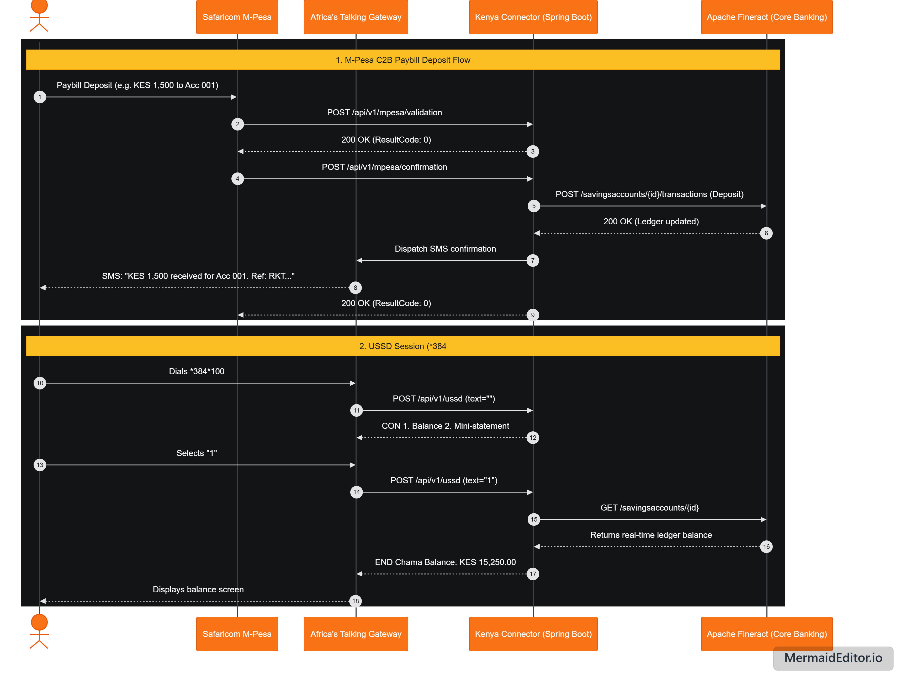

# 🇰🇪 Fineract Kenya Connector

[](https://openjdk.org/)
[](https://spring.io/projects/spring-boot)
[](https://fineract.apache.org/)
[](https://africastalking.com/)
[](https://www.docker.com/)
[](https://github.com/code-briomar)

Hooks up M-Pesa Paybill and Africa's Talking (USSD + SMS) straight into Apache Fineract core banking.

When someone pays your Paybill or dials \*384# on a phone, it automatically updates their savings account in Fineract and fires an instant SMS receipt.

## The Architecture



---

## Key Features

- **Safaricom C2B Webhook Handlers:** Instant `validation` and `confirmation` lifecycle handling with standard Safaricom JSON responses.
- **Apache Fineract Ledger Integration:** Maps mobile deposits directly into member savings accounts using Fineract's authenticated REST APIs.
- **Africa's Talking SMS Automation:** Sends immediate automated transaction receipts to members upon confirmed core banking ledger posting.
- **Interactive USSD Menu (`*384#`):** Low-bandwidth feature phone banking supporting self-service balance checks and mini-statements using the `CON`/`END` protocol.
- **Plug-and-Play Local Core Banking:** Pre-configured Docker Compose environment for Apache Fineract + PostgreSQL with automatic schema provisioning.

---

## Tech Stack

| Layer            | Technology                        |
| ---------------- | --------------------------------- |
| **Framework**    | Spring Boot 3.3.4 (Java 17)       |
| **Core Banking** | Apache Fineract (Containerized)   |
| **Database**     | PostgreSQL 15                     |
| **Telecom APIs** | Africa's Talking Java SDK 3.5.4   |
| **Mobile Money** | Safaricom Daraja C2B OpenAPI Spec |

---

## Quickstart

### 1. Clone & Set Up

```bash
git clone https://github.com/code-briomar/fineract-kenya-connector.git
cd fineract-kenya-connector
```

### 2. Launch Core Banking Engine

Start PostgreSQL and Apache Fineract:

```bash
docker compose up -d
```

_(Fineract takes ~1-2 minutes on first boot to run Liquibase migrations. Check logs with `docker logs -f fineract-server`)._

### 3. Run the Connector

```bash
./gradlew bootRun
```

The connector boots up at `http://localhost:8080`.

---

## Testing the APIs

### 1. Simulate an M-Pesa Paybill Deposit

Send a mock Safaricom confirmation webhook:

```powershell
$body = @{
    TransactionType   = "Pay Bill"
    TransID           = "RKT978HH7K"
    TransTime         = "20261112195700"
    TransAmount       = "1500.00"
    BusinessShortCode = "600000"
    BillRefNumber     = "ACC-CHAMA-001"
    MSISDN            = "254712345678"
    FirstName         = "Briane"
} | ConvertTo-Json
Invoke-RestMethod -Uri "http://localhost:8080/api/v1/mpesa/confirmation" -Method Post -Body $body -ContentType "application/json"
```

### 2. Simulate USSD Dialing (`*384#`)

Dial the USSD gateway:

```powershell
# Initial Menu Dial
Invoke-RestMethod -Uri "http://localhost:8080/api/v1/ussd" -Method Post -Body "sessionId=s1&serviceCode=*384*100#&phoneNumber=+254712345678&text=" -ContentType "application/x-www-form-urlencoded"
# Select 1: Check Balance
Invoke-RestMethod -Uri "http://localhost:8080/api/v1/ussd" -Method Post -Body "sessionId=s1&serviceCode=*384*100#&phoneNumber=+254712345678&text=1" -ContentType "application/x-www-form-urlencoded"
```

---

## Project Structure

```text
src/main/java/com/kenyafintech/connector/
├── controller/
│   ├── MpesaWebhookController.java    # Handles C2B Validation & Confirmation
│   └── UssdController.java            # Africa's Talking USSD session state
├── model/
│   └── MpesaC2BPayload.java           # Safaricom payload mapping
├── service/
│   ├── FineractClient.java            # Fineract REST client & SSL setup
│   └── NotificationService.java       # Africa's Talking SMS integration
└── ConnectorApplication.java          # Spring Boot Main
```

---

## 📄 License

MIT License. Feel free to fork and build on top of this!
